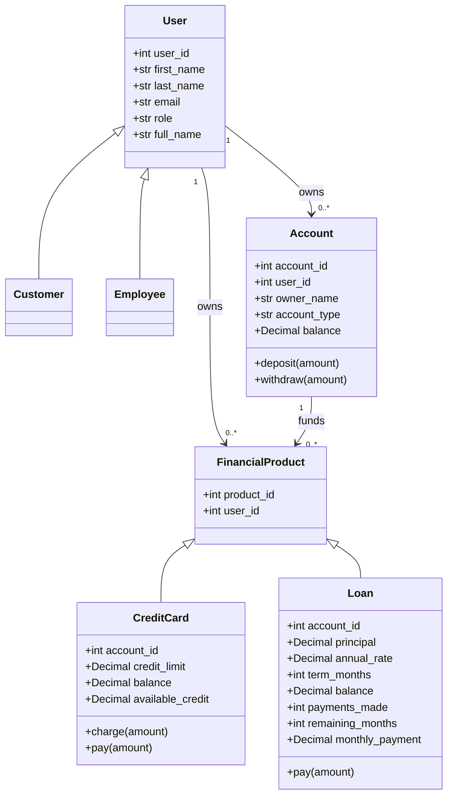

# Models UML

`Customer` and `Employee` inherit the user fields and set the user's role.
Product IDs are assigned independently by the credit card and loan tables, so
the same numeric ID can identify one of each.
